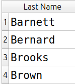
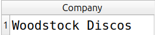
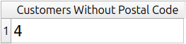
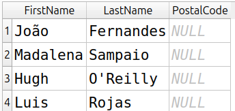

# Módulo 04: Filtros, ordenação e valores nulos

- **Projeto:** 01 - SQL Quick Start
- **Banco/Dataset:** Chinook (SQLite)
- **Status:** Em andamento

Exercícios sobre a tabela `customers`, praticando `WHERE`, `LIKE`, `ORDER BY`, `LIMIT`, `IS NULL` e a função `COUNT`.

## Índice

1. [Exercício 1: sobrenomes que começam com B](#exercício-1-sobrenomes-que-começam-com-b)
2. [Exercício 2: empresa no topo da ordem decrescente](#exercício-2-empresa-no-topo-da-ordem-decrescente)
3. [Exercício 3: clientes sem CEP](#exercício-3-clientes-sem-cep)

---

## Exercício 1: sobrenomes que começam com B

### Pergunta
Quantos clientes têm o sobrenome começando com a letra B?

### Consulta
```sql
SELECT
    LastName AS [Last Name]
FROM
  customers
WHERE
   LastName LIKE 'B%'
ORDER BY
  LastName ASC;
```

### Resultado


### Interpretação
Há **4** clientes cujo sobrenome começa com B.

### Limitações e decisões
- **Decisões de interpretação:** usei `LIKE 'B%'`, em que `%` significa "qualquer sequência de caracteres depois do B".
- **O que o resultado não diz:** no SQLite, o `LIKE` não diferencia maiúsculas de minúsculas para letras comuns, então sobrenomes digitados em minúsculo também entram na contagem.

---

## Exercício 2: empresa no topo da ordem decrescente

### Pergunta
Ao ordenar a tabela de clientes pela empresa, em ordem decrescente, qual empresa aparece primeiro?

### Consulta
```sql
SELECT
    Company
FROM
  customers
ORDER BY
  Company DESC
LIMIT 1;
```

### Resultado


### Interpretação
A empresa que aparece primeiro, na ordem decrescente (de Z para A), é **Woodstock Discos**.

### Limitações e decisões
- **Decisões de interpretação:** usei `LIMIT 1` para mostrar só a primeira linha, em vez de conferir a tabela inteira.
- **O que o resultado não diz:** nem todo cliente tem empresa cadastrada, e esses campos são `NULL`. No SQLite, `NULL` é tratado como o menor valor possível, então vai para o final na ordem decrescente. Em outros bancos, como o PostgreSQL, os `NULL` aparecem primeiro nessa mesma ordem, e o resultado seria diferente.
- **Alternativas consideradas:** `WHERE Company IS NOT NULL` deixaria explícito que os vazios foram descartados, independentemente do banco.

---

## Exercício 3: clientes sem CEP

### Pergunta
Quantos clientes não têm CEP cadastrado?

### Pergunta
Quantos clientes não têm CEP cadastrado e quem são eles?

### Consulta 1: quantos são
```sql
SELECT
    COUNT(*) AS [Customers Without Postal Code]
FROM
  customers
WHERE
  PostalCode IS NULL;
```

### Consulta 2: quem são
```sql
SELECT
    FirstName,
    LastName,
    PostalCode
FROM
  customers
WHERE
  PostalCode IS NULL
ORDER BY LastName;
```

### Resultado




### Interpretação
**4** clientes não têm CEP registrado. São eles: **João Fernandes, Hugh O'Reilly, Luis Rojas, Madalena Sampaio**.

### Limitações e decisões
- **Por que duas consultas:** a primeira dá o número exato e a segunda identifica os clientes. Uma não substitui a outra.
- **Abordagem do livro:** a solução proposta lista os clientes ordenados por `PostalCode`, o que coloca os `NULL` no topo no SQLite, mas exige contar as linhas manualmente. Usei `IS NULL` por ser mais explícito e não depender da ordenação de `NULL` do banco.
- **O que o resultado não diz:** só são encontrados campos `NULL`; um CEP preenchido com texto vazio (`''`) não seria contado.
