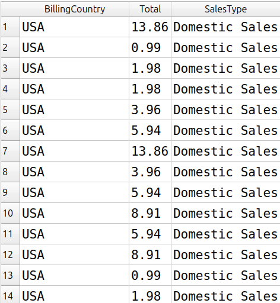
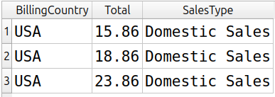
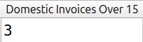

# Módulo 05: Lógica condicional com CASE

- **Projeto:** 01 - SQL Quick Start
- **Banco/Dataset:** Chinook (SQLite)
- **Status:** Concluído

Exercícios sobre a tabela `invoices`, praticando `CASE`, aliases, `ORDER BY` e filtros sobre um campo criado na própria consulta.

## Índice

1. [Exercício 1: rótulos de venda com CASE](#exercício-1-rótulos-de-venda-com-case)
2. [Exercício 3: faturas domésticas acima de 15](#exercício-3-faturas-domésticas-acima-de-15)

---

## Exercício 1: rótulos de venda com CASE

### Pergunta
Classificar cada fatura como venda doméstica (país de cobrança nos EUA) ou venda internacional (qualquer outro país), criar esse rótulo em uma nova coluna chamada `SalesType` e ordenar o resultado por ela.

### Consulta
```sql
SELECT
    BillingCountry,
    Total,
    CASE
        WHEN BillingCountry = 'USA' THEN 'Domestic Sales'
        ELSE 'Foreign Sales'
    END AS [SalesType]
FROM invoices
ORDER BY SalesType;
```

### Resultado


*O print mostra apenas as primeiras linhas.*

### Interpretação
Cada fatura ganhou um rótulo conforme o país de cobrança. Como a ordenação é alfabética sobre o texto, as vendas "Domestic Sales" aparecem antes das "Foreign Sales".

### Limitações e decisões
- **Decisões de interpretação:** usei o `ELSE` para agrupar todos os países que não são os EUA em um único rótulo, sem listar um por um.
- **O que o resultado não diz:** o rótulo é criado só na saída da consulta, e a tabela `invoices` não é alterada. Além disso, a classificação usa `BillingCountry`, o país de cobrança, que pode ser diferente do país do cliente.
- **Alternativas consideradas:** `ORDER BY` com o número da coluna também funcionaria, mas usar o nome do alias deixa a consulta mais legível.

---

## Exercício 3: faturas domésticas acima de 15

### Pergunta
Quantas faturas de vendas domésticas têm valor acima de 15 dólares?

### Consulta 1: quais são
```sql
SELECT
    BillingCountry,
    Total,
    CASE
        WHEN BillingCountry = 'USA' THEN 'Domestic Sales'
        ELSE 'Foreign Sales'
    END AS [SalesType]
FROM invoices
WHERE SalesType = 'Domestic Sales'
  AND Total > 15
ORDER BY SalesType;
```

### Consulta 2: quantas são
```sql
SELECT
    COUNT(*) AS [Domestic Invoices Over 15]
FROM invoices
WHERE BillingCountry = 'USA'
  AND Total > 15;
```

### Resultado




### Interpretação
Há 3 faturas de vendas domésticas com valor acima de 15 dólares.

### Limitações e decisões
- **Por que duas consultas:** a primeira lista as faturas e a segunda dá o número exato, sem precisar contar linhas na tela.
- **Decisões de interpretação:** "acima de 15" foi lido como estritamente maior (`>`), então uma fatura de exatamente 15 não entra.
- **O que o resultado não diz:** na primeira consulta, o filtro usa o alias `SalesType` dentro do `WHERE`. O SQLite aceita isso, mas outros bancos, como PostgreSQL e SQL Server, não aceitam, porque o `WHERE` é avaliado antes do `SELECT`. Nesses bancos seria preciso repetir o `CASE` ou usar uma subconsulta.
- **Alternativas consideradas:** para apenas contar, o `CASE` é dispensável, já que `BillingCountry = 'USA'` dá o mesmo resultado. Mantive o `CASE` na primeira consulta porque o exercício pede o uso do rótulo.
