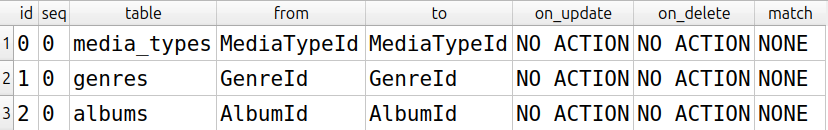
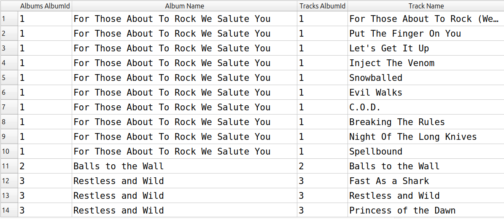
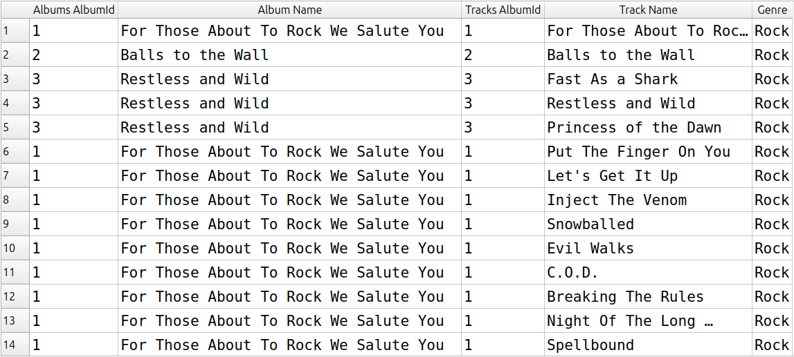

# Módulo 06: Trabalhando com múltiplas tabelas

- **Projeto:** 01 - SQL Quick Start
- **Banco/Dataset:** Chinook (SQLite)
- **Status:** Em andamento

Exercícios sobre a tabela `tracks` e suas ligações com outras tabelas, praticando chaves estrangeiras, `INNER JOIN`, aliases de tabela e de coluna.

## Índice

1. [Exercício 1: chaves estrangeiras da tabela tracks](#exercício-1-chaves-estrangeiras-da-tabela-tracks)
2. [Exercício 2: álbuns e faixas com INNER JOIN](#exercício-2-álbuns-e-faixas-com-inner-join)
3. [Exercício 3: adicionando o gênero com um segundo JOIN](#exercício-3-adicionando-o-gênero-com-um-segundo-join)

---

## Exercício 1: chaves estrangeiras da tabela tracks

### Pergunta
Quais campos da tabela `tracks` são chaves estrangeiras e, a partir deles, com quais tabelas a `tracks` se relaciona?

### Consulta
Este exercício se resolve olhando a tabela e o diagrama de relacionamentos. Como conferência, o SQLite lista as chaves estrangeiras de uma tabela com um comando próprio:

```sql
PRAGMA foreign_key_list(tracks);
```

### Resultado


### Interpretação
Os campos `AlbumId`, `MediaTypeId` e `GenreId` da tabela `tracks` apontam para outras tabelas. Por meio deles, a `tracks` se relaciona com `albums`, `media_types` e `genres`.

### Limitações e decisões
- **Decisões de interpretação:** considerei como chaves estrangeiras os campos de `tracks` que apontam para a chave primária de outra tabela.
- **O que o resultado não diz:** a relação também existe no sentido contrário. Outras tabelas, como `invoice_items` e `playlist_track`, têm um campo que aponta para `TrackId`. Aqui o foco foi nas chaves que saem da `tracks`.
- **Alternativas consideradas:** o `PRAGMA` é específico do SQLite. Em outros bancos, essa informação fica em tabelas de metadados, e o comando seria diferente.

---

## Exercício 2: álbuns e faixas com INNER JOIN

### Pergunta
Ligar as tabelas `albums` e `tracks` e mostrar, em um único resultado, o nome de cada álbum e o nome de cada faixa.

### Consulta
```sql
SELECT
    a.AlbumId AS [Albums AlbumId],
    a.Title AS [Album Name],
    t.AlbumId AS [Tracks AlbumId],
    t.Name AS [Track Name]
FROM albums AS a
INNER JOIN tracks AS t
    ON a.AlbumId = t.AlbumId;
```

### Resultado


*O print mostra apenas as primeiras linhas.*

### Interpretação
Cada linha do resultado é uma faixa, acompanhada do nome do álbum a que pertence. Álbuns com várias faixas aparecem repetidos, uma vez para cada faixa.

### Limitações e decisões
- **Decisões de interpretação:** mantive as duas colunas `AlbumId` (uma de cada tabela) para mostrar que a ligação funciona: em todas as linhas os dois valores são iguais, porque é essa a condição do `ON`.
- **O que o resultado não diz:** o `INNER JOIN` só devolve linhas que têm correspondência nas duas tabelas. Um álbum sem nenhuma faixa, ou uma faixa sem álbum, ficaria de fora.
- **Alternativas consideradas:** em uma análise real, eu mostraria apenas uma das colunas `AlbumId`, já que são idênticas. Os aliases de tabela (`a` e `t`) deixam a consulta mais curta e indicam de qual tabela vem cada coluna.

---

## Exercício 3: adicionando o gênero com um segundo JOIN

### Pergunta
Ampliar a consulta anterior ligando também a tabela `genres`, para que o nome do gênero apareça junto com o álbum e a faixa.

### Consulta
```sql
SELECT
    a.AlbumId AS [Albums AlbumId],
    a.Title AS [Album Name],
    t.AlbumId AS [Tracks AlbumId],
    t.Name AS [Track Name],
    g.Name AS [Genre]
FROM albums AS a
INNER JOIN tracks AS t
    ON a.AlbumId = t.AlbumId
INNER JOIN genres AS g
    ON t.GenreId = g.GenreId;
```

### Resultado


*O print mostra apenas as primeiras linhas.*

### Interpretação
O resultado agora traz, para cada faixa, o álbum e o gênero musical. Como o gênero se liga à faixa (e não ao álbum), faixas do mesmo álbum podem ter gêneros diferentes.

### Limitações e decisões
- **Decisões de interpretação:** a terceira tabela se conecta pela `tracks`, usando `t.GenreId = g.GenreId`. A `tracks` funciona como ponte entre `albums` e `genres`.
- **O que o resultado não diz:** as tabelas `tracks` e `genres` têm uma coluna chamada `Name`. Por isso usei o alias de tabela (`g.Name`) e renomeei a coluna para `Genre`, para não confundir com o nome da faixa.
- **Alternativas consideradas:** cada `INNER JOIN` adicional aplica o mesmo filtro de correspondência. Uma faixa sem gênero cadastrado ficaria de fora do resultado. Para mantê-la, seria preciso um `LEFT JOIN`, assunto que pretendo revisitar quando o livro chegar nele.
