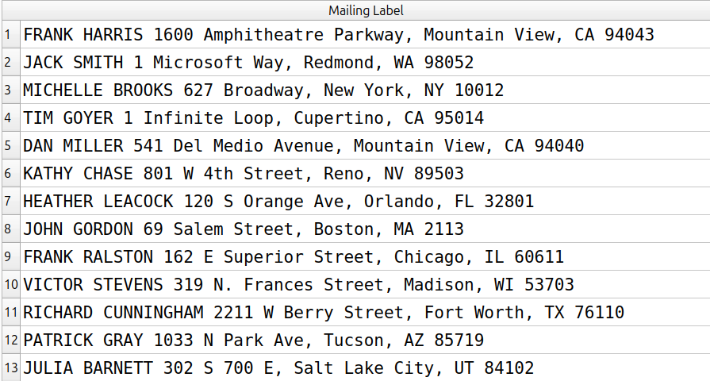
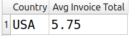
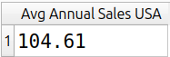
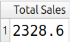
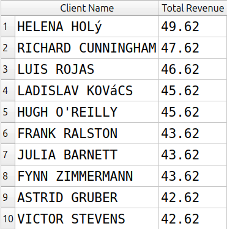

# Módulo 07: Funções de texto, agregações e GROUP BY

- **Projeto:** 01 - SQL Quick Start
- **Banco/Dataset:** Chinook (SQLite)
- **Status:** Concluído

Exercícios sobre as tabelas `customers` e `invoices`, praticando concatenação e funções de texto, funções de agregação, `GROUP BY`, `INNER JOIN`, `ORDER BY` e `LIMIT`.

## Índice

1. [Exercício 1: lista de endereçamento dos clientes dos EUA](#exercício-1-lista-de-endereçamento-dos-clientes-dos-eua)
2. [Exercício 2: média de vendas dos EUA](#exercício-2-média-de-vendas-dos-eua)
3. [Exercício 3: total de vendas da empresa](#exercício-3-total-de-vendas-da-empresa)
4. [Exercício 4: dez melhores clientes por receita](#exercício-4-dez-melhores-clientes-por-receita)

---

## Exercício 1: lista de endereçamento dos clientes dos EUA

### Pergunta
Montar, em uma única linha por cliente dos EUA, o nome completo em letras maiúsculas seguido do endereço completo, com CEP de cinco dígitos, no formato `NOME SOBRENOME Endereço, Cidade, UF 00000`.

### Consulta
```sql
SELECT
    UPPER(FirstName) || ' ' || UPPER(LastName) || ' ' ||
    Address || ', ' || City || ', ' || State || ' ' ||
    SUBSTR(PostalCode, 1, 5) AS [Mailing Label]
FROM customers
WHERE Country = 'USA';
```

### Resultado


### Interpretação
Cada linha do resultado é uma etiqueta de correspondência pronta, com nome em maiúsculas, endereço, cidade, estado e CEP reduzido a cinco dígitos.

### Limitações e decisões
- **Decisões de interpretação:** o operador `||` concatena os textos, e `SUBSTR(PostalCode, 1, 5)` pega os cinco primeiros caracteres do CEP, descartando o complemento depois do hífen (como em `94043-1351`).
- **O que o resultado não diz:** a consulta só recorta o texto e não corrige o dado. Se algum CEP estiver armazenado com menos de cinco dígitos (por exemplo, por perda do zero à esquerda), ele continuará com menos de cinco.
- **Alternativas consideradas:** o país não aparece na etiqueta, porque o formato pedido não o inclui e o filtro `Country = 'USA'` já garante que todos são dos EUA.

---

## Exercício 2: média de vendas dos EUA

### Pergunta
Qual é a média de vendas dos clientes dos EUA, considerando todos os anos disponíveis nos dados?

### Consulta 1: média por fatura
```sql
SELECT
    BillingCountry AS [Country],
    ROUND(AVG(Total), 2) AS [Avg Invoice Total]
FROM invoices
WHERE BillingCountry = 'USA';
```

### Consulta 2: média por ano (complemento)
```sql
SELECT
    ROUND(SUM(Total) / COUNT(DISTINCT STRFTIME('%Y', InvoiceDate)), 2) AS [Avg Annual Sales USA]
FROM invoices
WHERE BillingCountry = 'USA';
```

### Resultado




### Interpretação
Em média, cada fatura dos EUA vale 5.75 dólares. Já o total vendido por ano nos EUA é, em média, de 104.61 dólares.

### Limitações e decisões
- **Decisões de interpretação:** o enunciado fala em "média de vendas anuais", mas a solução do livro calcula a média por fatura (`AVG(Total)`). Resolvi conforme o livro e, como complemento, calculei também a média por ano (total ÷ número de anos).
- **O que o resultado não diz:** `AVG` divide pelo número de linhas, e cada linha de `invoices` é uma fatura. Por isso a primeira consulta é uma média por fatura, e não por ano nem por cliente. Na segunda, `COUNT(DISTINCT ...)` conta apenas anos em que houve venda para os EUA.
- **Alternativas consideradas:** a unidade da média muda a pergunta que o número responde:

| Pergunta | Cálculo |
|----------|---------|
| Quanto vale uma fatura, em média? | `AVG(Total)` |
| Quanto vendemos por ano, em média? | `SUM(Total)` ÷ nº de anos |
| Quanto cada cliente gerou, em média? | `SUM(Total)` ÷ nº de clientes |

---

## Exercício 3: total de vendas da empresa

### Pergunta
Qual é o total de vendas da empresa em toda a sua história?

### Consulta
```sql
SELECT
    ROUND(SUM(Total), 2) AS [Total Sales]
FROM invoices;
```

### Resultado


### Interpretação
A empresa vendeu 2328.6 dólares em todo o período registrado nos dados.

### Limitações e decisões
- **Decisões de interpretação:** somei o campo `Total` de todas as faturas, sem nenhum filtro.
- **O que o resultado não diz:** o número reflete apenas o que está registrado em `invoices`, sem considerar devoluções, impostos ou custos.
- **Alternativas consideradas:** usei `ROUND(..., 2)` porque a soma de valores decimais pode vir com casas a mais por imprecisão de ponto flutuante.

---

## Exercício 4: dez melhores clientes por receita

### Pergunta
Quem são os dez clientes que mais geraram receita?

### Consulta
```sql
SELECT
    UPPER(c.FirstName) || ' ' || UPPER(c.LastName) AS [Client Name],
    ROUND(SUM(i.Total), 2) AS [Total Revenue]
FROM invoices AS i
INNER JOIN customers AS c
    ON c.CustomerId = i.CustomerId
GROUP BY
    c.CustomerId,
    c.FirstName,
    c.LastName
ORDER BY SUM(i.Total) DESC
LIMIT 10;
```

### Resultado


### Interpretação
O cliente que mais gerou receita é Helena Holý, com 49.62 dólares, seguido de Richard Cunningham. A lista traz os dez clientes ordenados da maior para a menor receita.

### Limitações e decisões
- **Decisões de interpretação:** agrupei por `CustomerId` e também por nome e sobrenome, porque toda coluna do `SELECT` que não é função de agregação precisa estar no `GROUP BY` em bancos mais rigorosos.
- **O que o resultado não diz:** se houvesse empate de valores na décima posição, o `LIMIT 10` cortaria um deles de forma arbitrária. A receita também considera apenas o valor das faturas.
- **Alternativas consideradas:** o SQLite aceita omitir colunas do `GROUP BY`, mas outros bancos nem sempre. O SQL Server e o Oracle exigem todas as colunas não agregadas no `GROUP BY`. O PostgreSQL permite agrupar apenas pela chave primária da tabela, mas só nesse caso, e por isso listar as colunas é a forma portável.
