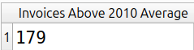
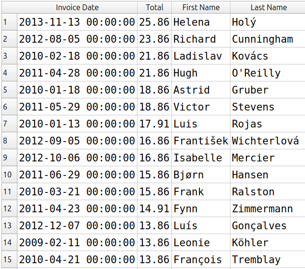
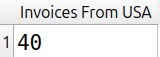
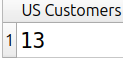

# Módulo 08: Subconsultas

- **Projeto:** 01 - SQL Quick Start
- **Banco/Dataset:** Chinook (SQLite)
- **Status:** Em andamento

Exercícios sobre as tabelas `invoices` e `customers`, praticando subconsultas no `WHERE`, a função de data `STRFTIME`, `COUNT`, `INNER JOIN` e `ORDER BY`.

## Índice

1. [Exercício 1: faturas acima da média de 2010](#exercício-1-faturas-acima-da-média-de-2010)
2. [Exercício 2: clientes responsáveis por essas faturas](#exercício-2-clientes-responsáveis-por-essas-faturas)
3. [Exercício 3: quantos são dos EUA](#exercício-3-quantos-são-dos-eua)

---

## Exercício 1: faturas acima da média de 2010

### Pergunta
Quantas faturas têm valor acima do valor médio das faturas emitidas em 2010?

### Consulta 1: quantas são
```sql
SELECT
    COUNT(*) AS [Invoices Above 2010 Average]
FROM invoices
WHERE Total > (
    SELECT AVG(Total)
    FROM invoices
    WHERE STRFTIME('%Y', InvoiceDate) = '2010'
);
```

### Consulta 2: qual é a média de 2010 (apoio)
```sql
SELECT
    ROUND(AVG(Total), 2) AS [Avg Invoice 2010]
FROM invoices
WHERE STRFTIME('%Y', InvoiceDate) = '2010';
```

### Resultado


A média de 2010 usada como limite é de 5.8 dólares.

### Interpretação
Há 179 faturas com valor acima da média de 2010, que é de 5.8 dólares por fatura.

### Limitações e decisões
- **Decisões de interpretação:** a subconsulta calcula a média apenas de 2010, e a consulta externa compara com ela as faturas de **todos os anos**. Outra leitura possível seria contar só as faturas de 2010 acima da própria média; escolhi a primeira porque o enunciado não restringe o ano das faturas contadas.
- **O que o resultado não diz:** a comparação é estrita (`>`), então uma fatura exatamente igual à média não entra. A média é por fatura, não por cliente nem por ano.
- **Alternativas consideradas:** a subconsulta é executada uma única vez, porque não depende da consulta externa, e o seu resultado funciona como um valor fixo. O filtro de ano com `STRFTIME` também poderia ser escrito com um intervalo de datas (`InvoiceDate >= '2010-01-01' AND InvoiceDate < '2011-01-01'`).

---

## Exercício 2: clientes responsáveis por essas faturas

### Pergunta
Quais clientes são responsáveis pelas faturas acima da média de 2010?

### Consulta
```sql
SELECT
    i.InvoiceDate AS [Invoice Date],
    i.Total AS [Total],
    c.FirstName AS [First Name],
    c.LastName AS [Last Name]
FROM invoices AS i
INNER JOIN customers AS c
    ON c.CustomerId = i.CustomerId
WHERE i.Total > (
    SELECT AVG(Total)
    FROM invoices
    WHERE STRFTIME('%Y', InvoiceDate) = '2010'
)
ORDER BY i.Total DESC;
```

### Resultado


*O print mostra apenas as primeiras linhas.*

### Interpretação
O resultado lista cada fatura acima da média de 2010 com a data, o valor e o nome do cliente, da maior para a menor. A maior fatura é de Helena Holý, no valor de 25.86 dólares.

### Limitações e decisões
- **Decisões de interpretação:** o `INNER JOIN` liga cada fatura ao seu cliente, e a subconsulta continua definindo o limite de valor.
- **O que o resultado não diz:** a lista tem uma linha por **fatura**, não por cliente. Um mesmo cliente aparece mais de uma vez se tiver várias faturas acima da média.
- **Alternativas consideradas:** para uma lista de clientes sem repetição, bastaria selecionar apenas nome e sobrenome com `SELECT DISTINCT`. Mantive a versão com data e valor por ser mais informativa.

---

## Exercício 3: quantos são dos EUA

### Pergunta
Entre os responsáveis por essas faturas, quantos são dos EUA?

### Consulta 1: faturas com cobrança nos EUA
```sql
SELECT
    COUNT(*) AS [Invoices From USA]
FROM invoices
WHERE Total > (
    SELECT AVG(Total)
    FROM invoices
    WHERE STRFTIME('%Y', InvoiceDate) = '2010'
)
AND BillingCountry = 'USA';
```

### Consulta 2: clientes distintos dos EUA
```sql
SELECT
    COUNT(DISTINCT c.CustomerId) AS [US Customers]
FROM invoices AS i
INNER JOIN customers AS c
    ON c.CustomerId = i.CustomerId
WHERE i.Total > (
    SELECT AVG(Total)
    FROM invoices
    WHERE STRFTIME('%Y', InvoiceDate) = '2010'
)
AND c.Country = 'USA';
```

### Resultado




### Interpretação
Há [N] faturas acima da média de 2010 com cobrança nos EUA, e elas pertencem a [N] clientes diferentes.

### Limitações e decisões
- **Por que duas consultas:** a primeira conta **faturas** e a segunda conta **clientes**. São unidades diferentes, e o enunciado fala em clientes. Quando um cliente tem mais de uma fatura acima da média, os dois números diferem.
- **Decisões de interpretação:** na primeira consulta usei `BillingCountry`, que já está em `invoices` e dispensa o `JOIN`. Na segunda usei `customers.Country`, que é o país do cliente.
- **O que o resultado não diz:** `BillingCountry` e `Country` são campos diferentes (país de cobrança e país do cliente) e podem não coincidir.
- **Alternativas consideradas:** não coloquei `ORDER BY` nessas consultas, porque cada uma devolve uma linha só e ordenar não muda nada.

### Observações

A mesma subconsulta aparece nas três perguntas. Se o ano de referência mudar, é preciso alterar a consulta em vários lugares, o que aumenta o risco de esquecer algum e deixar resultados inconsistentes.
Depois de aprender views, percebi que elas resolvem esse problema. 
Uma view guarda uma consulta com um nome, e eu posso usá-la como se fosse uma tabela. Assim, o cálculo da média de 2010 ficaria definido em um só lugar, e as consultas dos três exercícios apenas o reutilizariam. Se o ano de referência mudasse, bastaria alterar a view, e todas as consultas que dependem dela acompanhariam a mudança.
