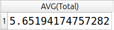
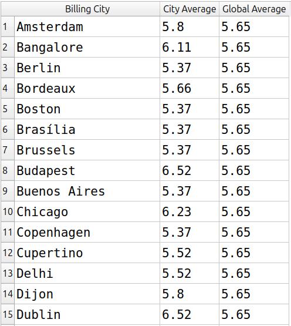
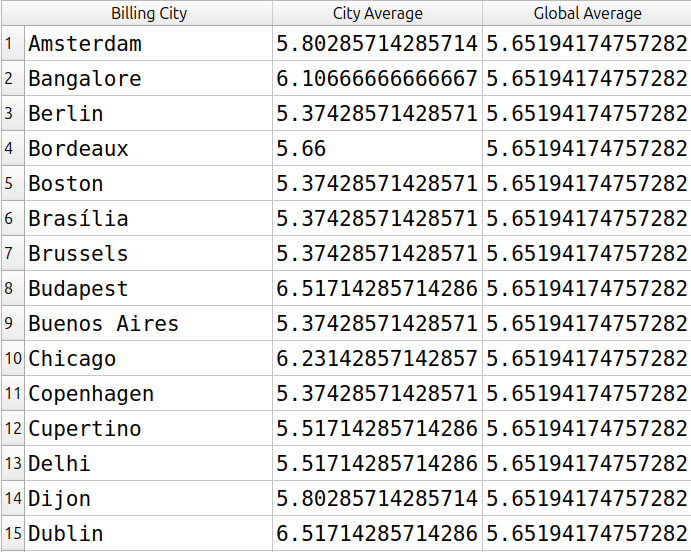
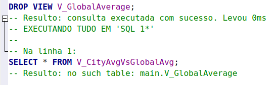

# Módulo 09: Views

- **Projeto:** 01 - SQL Quick Start
- **Banco/Dataset:** Chinook (SQLite)
- **Status:** Concluído

Exercícios sobre a tabela `invoices`, praticando `CREATE VIEW`, `DROP VIEW`, subconsulta no `SELECT`, `GROUP BY` e a dependência entre views.

> Atenção: `CREATE VIEW` grava a view dentro do arquivo do banco. Para reproduzir os exercícios, rode os comandos na ordem, de preferência em uma cópia do Chinook.

## Índice

1. [Exercício 1: view com a média global](#exercício-1-view-com-a-média-global)
2. [Exercício 2: usando a view no lugar da subconsulta](#exercício-2-usando-a-view-no-lugar-da-subconsulta)
3. [Exercício 3: salvando a consulta como view](#exercício-3-salvando-a-consulta-como-view)
4. [Exercício 4: apagando a view da qual outra depende](#exercício-4-apagando-a-view-da-qual-outra-depende)

---

## Exercício 1: view com a média global

### Pergunta
Pegar a subconsulta que calcula a média geral das faturas, usada em uma consulta do capítulo anterior, e salvá-la como uma view chamada `V_GlobalAverage`.

### Consulta
```sql
CREATE VIEW V_GlobalAverage AS
SELECT AVG(Total)
FROM invoices;
```

### Consulta de verificação
```sql
SELECT * FROM V_GlobalAverage;
```

### Resultado


### Interpretação
A view passou a existir no banco e devolve um único valor: a média de todas as faturas, que é de 5.65 dólares.

### Limitações e decisões
- **Decisões de interpretação:** a view guarda a **consulta**, e não o resultado. Cada vez que ela é usada, a média é recalculada com os dados atuais da tabela.
- **O que o resultado não diz:** como não dei um alias a `AVG(Total)`, a coluna da view se chama `AVG(Total)`. Seria mais legível nomeá-la, por exemplo com `AS [Global Average]`.
- **Alternativas consideradas:** rodar o `CREATE VIEW` uma segunda vez gera erro, porque a view já existe. Para repetir, é preciso apagá-la antes ou usar `CREATE VIEW IF NOT EXISTS`.

---

## Exercício 2: usando a view no lugar da subconsulta

### Pergunta
Reescrever a consulta que compara a média de cada cidade com a média global, trocando a subconsulta pela view `V_GlobalAverage`.

### Consulta
```sql
SELECT
    BillingCity AS [Billing City],
    ROUND(AVG(Total),2) AS [City Average],
    ROUND((SELECT * FROM V_GlobalAverage),2) AS [Global Average]
FROM invoices
GROUP BY BillingCity
ORDER BY BillingCity;
```

### Resultado


*O print mostra apenas as primeiras linhas.*

### Interpretação
Cada linha traz uma cidade de cobrança, a média das faturas dessa cidade e a média global, que se repete em todas as linhas para facilitar a comparação.

### Limitações e decisões
- **Decisões de interpretação:** substituí a subconsulta original por `(SELECT * FROM V_GlobalAverage)`. O resultado é o mesmo, mas o cálculo da média global agora está definido em um único lugar.
- **O que o resultado não diz:** `SELECT *` funciona aqui porque a view tem uma única coluna e uma única linha. Se a view tivesse mais de uma coluna, a consulta daria erro.
- **Alternativas consideradas:** a comparação continua sendo entre médias **por fatura**, não por cliente nem por ano.

>Usei ROUND(..., 2) para facilitar a leitura. O arredondamento é apenas de exibição e não altera os valores calculados.
---

## Exercício 3: salvando a consulta como view

### Pergunta
Salvar a consulta do exercício anterior como uma nova view chamada `V_CityAvgVsGlobalAvg`.

### Consulta
```sql
CREATE VIEW V_CityAvgVsGlobalAvg AS
SELECT
    BillingCity AS [Billing City],
    AVG(Total) AS [City Average],
    (SELECT * FROM V_GlobalAverage) AS [Global Average]
FROM invoices
GROUP BY BillingCity
ORDER BY BillingCity;
```

### Consulta de verificação
```sql
SELECT * FROM V_CityAvgVsGlobalAvg;
```

### Resultado


*O print mostra apenas as primeiras linhas.*

### Interpretação
A comparação entre cada cidade e a média global agora pode ser consultada pelo nome da view, sem reescrever o `GROUP BY` e a subconsulta.

### Limitações e decisões
- **Decisões de interpretação:** esta view depende de outra view (`V_GlobalAverage`). Uma view pode usar outras views, formando uma cadeia de dependências.
- **O que o resultado não diz:** o `ORDER BY` dentro da view é aceito pelo SQLite, mas alguns bancos, como o SQL Server, não permitem ordenar dentro da definição de uma view. Nesses casos, a ordenação é feita na consulta que usa a view.
- **Alternativas consideradas:** poderia deixar a view sem `ORDER BY` e ordenar ao consultá-la (`SELECT * FROM V_CityAvgVsGlobalAvg ORDER BY ...`), o que é mais portável.

---

## Exercício 4: apagando a view da qual outra depende

### Pergunta
O que acontece com `V_CityAvgVsGlobalAvg` quando a view `V_GlobalAverage` é apagada?

### Consulta 1: apagar a view
```sql
DROP VIEW V_GlobalAverage;
```

### Consulta 2: consultar a view dependente
```sql
SELECT * FROM V_CityAvgVsGlobalAvg;
```

### Resultado


Mensagem de erro:

```
no such table: main.V_GlobalAverage
```

### Interpretação
A view `V_CityAvgVsGlobalAvg` continua existindo no banco, mas deixa de funcionar. Ao ser consultada, ela procura `V_GlobalAverage`, que não existe mais, e o SQLite devolve um erro.

### Limitações e decisões
- **Decisões de interpretação:** a view guarda apenas o texto da consulta, e as referências a outras views só são resolvidas na hora de executar. Por isso o SQLite permitiu apagar `V_GlobalAverage` sem avisar e o problema só apareceu depois, ao usar a outra view.
- **O que o resultado não diz:** esse comportamento é do SQLite. O PostgreSQL, por exemplo, recusa apagar uma view da qual outras dependem, a menos que se use `CASCADE`, que apaga também as dependentes.
- **Alternativas consideradas:** para consertar, basta recriar `V_GlobalAverage` com o mesmo nome. A view dependente volta a funcionar sem precisar ser alterada.

### Observações
Views são o recurso que usei para revisitar o módulo 08, onde a mesma subconsulta se repetia em vários exercícios. A dependência entre views, vista neste exercício, mostra o outro lado: centralizar um cálculo facilita a manutenção, mas apagar ou alterar uma view pode quebrar outras que dependem dela.
