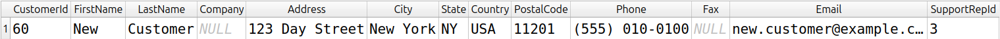
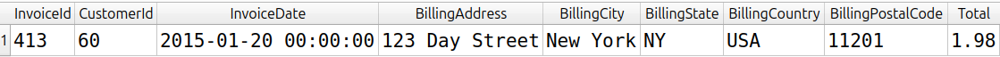
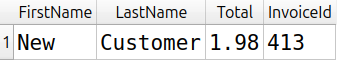
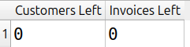

# Módulo 10: Inserindo e removendo dados

- **Projeto:** 01 - SQL Quick Start
- **Banco/Dataset:** Chinook (SQLite)
- **Status:** Em andamento

Exercícios sobre as tabelas `customers` e `invoices`, praticando `INSERT`, `DELETE` e a ordem das operações quando há relação entre tabelas.

> Atenção: estes comandos **alteram o banco**. Rode em uma cópia do Chinook e, no DB Browser for SQLite, lembre que as alterações só são gravadas no arquivo ao usar **Write Changes**. Os dados inseridos aqui são fictícios.

## Índice

1. [Exercício 1: adicionar um cliente](#exercício-1-adicionar-um-cliente)
2. [Exercício 2: criar uma fatura para o cliente](#exercício-2-criar-uma-fatura-para-o-cliente)
3. [Exercício 3: remover o cliente](#exercício-3-remover-o-cliente)

---

## Exercício 1: adicionar um cliente

### Pergunta
Adicionar um novo cliente ao banco de dados.

### Consulta 1: informando as colunas
```sql
INSERT INTO customers (
    FirstName, LastName, Address, City, State,
    Country, PostalCode, Phone, Email, SupportRepId
)
VALUES (
    'New', 'Customer', '123 Day Street', 'New York', 'NY',
    'USA', '11201', '(555) 010-0100', 'new.customer@example.com', 3
);
```

### Consulta 2: sem informar as colunas
```sql
INSERT INTO customers
VALUES (
    60, 'New', 'Customer', NULL, '123 Day Street', 'New York', 'NY',
    'USA', '11201', '(555) 010-0100', NULL, 'new.customer@example.com', 3
);
```

*As duas consultas são formas alternativas de inserir o mesmo cliente: rode apenas uma delas.*

### Consulta de verificação
```sql
SELECT *
FROM customers
WHERE Email = 'new.customer@example.com';
```

### Resultado


### Interpretação
O cliente foi inserido e recebeu o `CustomerId` 60. Na primeira forma, o número foi gerado automaticamente pelo SQLite.

### Limitações e decisões
- **Decisões de interpretação:** na primeira forma, listei as colunas e deixei de fora `CustomerId` (chave primária), `Company` e `Fax`. O SQLite gera o ID sozinho e preenche as colunas omitidas com `NULL`.
- **O que o resultado não diz:** na segunda forma, os valores precisam seguir exatamente a ordem e o número de colunas da tabela (13 valores). Qualquer troca de posição grava o dado na coluna errada. Nela, defini o ID manualmente, o que dá erro se esse número já existir, inclusive se a primeira forma tiver sido executada antes.
- **Alternativas consideradas:** para campos sem valor, usei `NULL` e não texto vazio (`''`). São coisas diferentes: `WHERE Company IS NULL` não encontra um campo com `''`, como vimos no módulo 04. A primeira forma é a mais segura, porque continua funcionando se a tabela ganhar colunas novas.

---

## Exercício 2: criar uma fatura para o cliente

### Pergunta
Criar uma fatura para o cliente que acabou de ser inserido.

### Consulta
```sql
INSERT INTO invoices (
    CustomerId, InvoiceDate, BillingAddress, BillingCity,
    BillingState, BillingCountry, BillingPostalCode, Total
)
VALUES (
    60,
    '2015-01-20 00:00:00',
    '123 Day Street',
    'New York',
    'NY',
    'USA',
    '11201',
    1.98
);
```

### Consulta de verificação
```sql
SELECT *
FROM invoices
WHERE CustomerId = 60;
```

### Resultado


### Interpretação
A fatura foi criada e ligada ao cliente pelo `CustomerId`. O `InvoiceId` foi gerado automaticamente, com o valor [ID].

### Limitações e decisões
- **Decisões de interpretação:** usei o `CustomerId` 60, gerado no exercício anterior, e o mesmo endereço do cliente como endereço de cobrança. A data segue o formato das demais faturas (`AAAA-MM-DD HH:MM:SS`).
- **O que o resultado não diz:** a fatura não tem itens na tabela `invoice_items`, então o `Total` de 1,98 não corresponde a nenhuma compra registrada. Também fica com data posterior às demais, o que alteraria análises por ano (como as dos módulos 07 e 08) se ela permanecesse no banco.
- **Alternativas consideradas:** em vez de digitar o ID, dá para buscá-lo com uma subconsulta (`(SELECT CustomerId FROM customers WHERE Email = '...')`), o que evita erro se o número gerado não for 60.

---

## Exercício 3: remover o cliente

### Pergunta
Remover o cliente criado do banco de dados.

### Consulta 1: conferir o que será removido
```sql
SELECT
    c.FirstName,
    c.LastName,
    i.Total,
    i.InvoiceId
FROM invoices AS i
INNER JOIN customers AS c
    ON i.CustomerId = c.CustomerId
WHERE c.CustomerId = 60;
```

### Consulta 2: remover
```sql
DELETE FROM invoices WHERE CustomerId = 60;
DELETE FROM customers WHERE CustomerId = 60;
```

### Consulta 3: conferir a remoção
```sql
SELECT
    (SELECT COUNT(*) FROM customers WHERE CustomerId = 60) AS [Customers Left],
    (SELECT COUNT(*) FROM invoices WHERE CustomerId = 60) AS [Invoices Left];
```

### Resultado




### Interpretação
Antes da remoção, a consulta mostrava o cliente e a sua fatura. Depois, as duas contagens devolvem 0, ou seja, o cliente e a fatura deixaram de existir.

### Limitações e decisões
- **Decisões de interpretação:** apaguei primeiro a fatura e depois o cliente, porque a fatura depende do cliente. Com a verificação de chaves estrangeiras ativa (o DB Browser a ativa por padrão), apagar o cliente antes geraria erro.
- **O que o resultado não diz:** `DELETE` não tem desfazer. Por isso rodei antes um `SELECT` com o mesmo `WHERE`, para ver exatamente quais linhas seriam afetadas. Se a fatura tivesse itens em `invoice_items`, eles também precisariam ser apagados antes.
- **Alternativas consideradas:** para conferir a remoção, não basta repetir a consulta com `INNER JOIN`, porque ela também devolveria zero linhas se só a fatura tivesse sido apagada. Contar cada tabela separadamente confirma as duas remoções.
